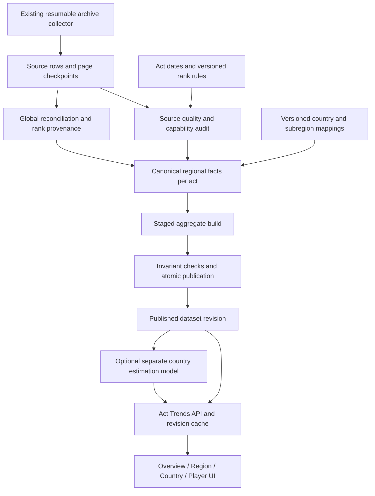

# Historical competitive landscape: architecture and implementation handoff

Status: proposed design, not implemented. Prepared 26 October 2026.

Audience: engineers, product designers, and implementation agents extending this repository.

## 1. Objective and scope

Build an **Act Trends** experience that explains how each region and reported country changes from act to act: observed leaderboard size, Radiant and Immortal representation, rank composition, relative share, and the breadth of emerging competitive scenes.

The product measures the **observed PC high-rank competitive landscape across six covered regional shards**. It does not measure all VALORANT players, unique people, national market size, revenue, or total competitive participation. China, console, lower ranks, and players missing from archived leaderboards are outside this dataset.

Use “emerging competitive scenes” rather than asserting “emerging markets.” A growing leaderboard presence is a useful signal, but it is not evidence of growth in all players or commercial demand.

Deliver this inside the existing application. Preserve Current views, historical single-act pages, the running archive, and existing live collection configuration. Do not replace the collector or introduce a new frontend framework merely for this feature.

### Core questions

1. Is a region's observed high-rank ladder expanding, contracting, or apparently capped?
2. Is a country gaining observed players, gaining regional share, or both?
3. Is its rank mix moving toward higher tiers, and is that improvement stronger than the surrounding region's change?
4. Does it have competitive depth across many accounts, rather than one exceptional account?
5. Are changes persistent across comparable acts or isolated spikes?
6. How much of every conclusion depends on missing country labels, archive quality, rank rules, or ladder truncation?

### Required distinction

Keep **size**, **rank mix**, and **relative representation** separate. Never compress them into an unexplained national skill or market-health score.

## 2. Repository starting point

Inspect these existing files before implementation:

- `leaderboard-service/src/main/java/com/valorant/leaderboard/HistoricalActArchiveService.java`: acquisition, status, archived player and aggregate responses.
- `leaderboard-service/src/main/java/com/valorant/leaderboard/LeaderboardController.java`: act-aware API routing.
- `leaderboard-service/src/main/resources/db/migration/V7__historical_act_archive.sql`: source archive schema.
- `leaderboard-service/src/main/resources/static/leaderboard.html`: existing overview, regional, country, and global UI.
- `docs/HISTORICAL_ACT_BACKFILL_ANALYSIS.md`: initial archive analysis. Treat it as historical documentation; this handoff tightens its assumptions about completeness and timestamps.
- `build/historical-ui-evidence.json`: sampled API evidence used for this design. This build artifact may be cleaned; retain the audit facts below in this document.

The archive catalogue exposes 35 previous acts and a separate current act. Each historical act has Global plus AP, EU, NA, LATAM, BR, and KR source ladders. Current schema stores act, source shard, player shard, name-derived key, display name, reported country, source rank, RR, tier, wins, provider update time, and fetch time.

The source primary key includes source shard; Global and regional copies are **not independent players**. Summing `historical_act_sources.players` double-counts overlapping records.

Current historical endpoints select a single act. They do not provide a cross-act analytical series. Historical hourly activity is unavailable and must remain unavailable.

## 3. Audit findings that must shape the implementation

These are observations from this local archive/API on 26 October, not claims that the provider's original historical season had exactly these populations.

### A. Global source completeness cannot be inferred from collection completion

- V26 Act V Global returned all six regions and 53,775 entries, matching the sum of regional source counts in this sample.
- V26 Act IV Global exposed only Europe, 13,237 entries. Regional sources together contained 46,354 entries across six shards.
- Episode 8 Act III Global exposed only KR, 3,573 entries. Regional sources together contained 45,998 entries.

Consequently, existing historical world aggregation based only on `source_region=global` is not a dependable world denominator. HTTP success, matching request filters, and a terminal page establish successful retrieval, not semantic completeness.

**Decision:** derive landscape counts from validated regional ladders. Use Global as supplementary ranking evidence and an audit source. Never append Global rows to regional counts or invent missing provider global positions.

### B. Source rank granularity differs from game-era rank granularity

Episode 8 Act III AP returned 429 Radiants and 11,327 combined Immortals, with all three subdivision counters zero. Riot had already restored Immortal 1/2/3 by then. These zero subdivision counters mean unavailable subdivision detail, not no Immortal 1/2/3 players.

**Decision:** record both game rules and actual source capability. Offer `Immortal — all` across compatible archives; show missing subdivision values as null/unavailable. Do not reconstruct tiers from today's RR thresholds.

### C. Country coverage is low

V26 Act V AP contains 14,998 entries, of which 5,471 have reported countries and 9,527 do not: 36.5% known-country coverage. Its Radiant pool has 499 entries, 289 with unknown country. Coverage must be calculated separately for each act, shard, tier, and rank cohort.

**Decision:** known-country share must explicitly state its denominator. No observed India-labelled Radiants means no such records observed, not proof that India had no Radiants.

### D. A real example of conflicting growth signals

India in AP, V26 Act III to V26 Act V:

- Observed entries: 447 → 308, a 31.1% decrease.
- Immortal 3 entries: 41 → 62, a 51.2% increase.
- Immortal 3 share of India's observed entries: 9.2% → 20.1%, up 11.0 percentage points.
- India's share of known-country AP Immortal 3 entries: 41/1,002 → 62/1,807, or 4.1% → 3.4%, down about 0.7 percentage points.
- India's share of all known-country AP entries: 8.1% → 5.6%.

Correct interpretation: fewer observed India-labelled entries; more Immortal 3 entries and a higher internal Immortal 3 mix; nevertheless a smaller share of the region's known-country Immortal 3 pool. This is not a simple “India improved” or “India declined” story.

### E. Snapshot and cap limitations

Old acts carry provider refresh timestamps from the present retrieval period. They do not establish exact historical capture time. Repeated ladder sizes near 15,000 or 5,000 suggest possible source limits; these observations alone do not prove an official cap.

**Decision:** call these “archived standings,” not verified act-end snapshots. Flag suspected truncation and preserve the distinction between source-exhausted and known population-complete.

## 4. Data semantics and prohibited inferences

### Supported with qualified provenance

- Count of observed leaderboard entries by country/shard/tier/act.
- Within-country tier composition and reported-country representation.
- RR quantiles within a shard and compatible rules period.
- Cumulative act-win distribution among accounts present on the archived board.
- Regional rank cohorts, if rank ordering and requested depth are available.
- An observed Radiant boundary point per act and shard, if tier/rank evidence is adequate.

### Not supported by one standings snapshot per act

- Match counts, losses, win rate, active players in an hourly interval, playtime, server played, map/agent playstyle, or reactions to losing rounds.
- Exact promotions/demotions between acts; resets and eligibility changes intervene.
- Churn, retention, or migration as verified account behavior using a name-derived identity alone.
- Historical nationality/residence from a profile country fetched today.
- Equal competitive skill from equal RR in different shards/eras.
- All-player national participation or an economic market-growth estimate.

Do not subtract cumulative wins across acts. They belong to separate acts. Do not reuse the live adjacent-snapshot assumed-loss method across act boundaries. Match analysis remains a separate, consent/access-aware pipeline.

## 5. Target architecture



Implement within the existing Spring Boot/PostgreSQL stack. Suggested responsibilities, not mandatory class names:

- `HistoricalArchiveQualityService`: audit pagination, duplicates, rank coverage, source differences, capabilities.
- `HistoricalCanonicalizationService`: select regional facts, retain conflicts/provenance, attach compatible Global rank evidence.
- `HistoricalTrendPublicationService`: build a revision, run invariants, atomically publish.
- `HistoricalTrendQueryService`: bounded aggregate queries, comparison and classification.
- `HistoricalTrendController`: explicit cross-act contracts, independent of hourly APIs.

A failed analytical build must leave the previous published revision available. Collection must continue if a trend build fails. Use one background publication worker with bounded batches; avoid putting archive-wide analytical work on request threads.

## 6. Canonicalization and quality policy

### Canonical entry

Default key: `(act, player_shard, normalized_source_player_key)`. This is a leaderboard-entry key, not a guaranteed unique human or cross-act account key. Preserve original spelling and normalization version. Anonymous/shared placeholder names require a source identifier; otherwise mark identity ambiguous and do not merge by display name.

1. Regional rows are authoritative for regional membership, regional position, and analytical counts for that shard.
2. Within the same act/shard, attach Global evidence only when identity and relevant fields agree. Preserve disagreements, never choose the higher RR merely because it looks better.
3. If RR/tier/country conflicts exist, keep the regional value as the published source-selected value with a conflict flag. Provide consistent and flagged subtotals. Exclude flagged rows from RR-boundary and fine-grained performance conclusions by default.
4. A missing regional source remains missing. Global-only data may be offered as a separately labelled provisional view, but cannot silently replace a regional series.
5. Country null, blank, malformed, or conflicting without a selected regional value remains Unknown. Never map missing countries to the shard's namesake country.
6. South Korea country `kr` and Korea shard `kr` are distinct dimensions. Korea-labelled accounts may appear in AP; AP must not be renamed SEA. Normalize display aliases to South Korea without rewriting factual country assignments.
7. Source-provided global rank is nullable. If a derived RR sort is offered, label it “RR order across covered shards”; it is not official global competitive rank.

### Quality is multidimensional

Store separate fields for:

- Collection: pending / collecting / retrying / terminal-source-reached / failed.
- Population extent: unknown / apparently capped / truncated / independently verified.
- Identity quality: stable identifier / name key / ambiguous.
- Tier capability: subdivisions available / combined only / mixed or partial / unavailable.
- Country coverage: known and unknown counts, including per-tier coverage.
- Source agreement: matching / divergent / Global incomplete / not assessable.
- Capture semantics: archived standings / verified act-end, with evidence.
- Comparability: compatible / caution / incompatible, **per metric and comparison**.

Allow a valid combined-Immortal comparison even if Immortal 2 is unavailable. A missing Global ladder must not block a valid regional count comparison. Failed regional scope must not produce a world headline falsely covering all six regions.

## 7. Logical schema additions

Use new additive migrations; do not rewrite V7 or destructively modify raw evidence. Choose migration numbers after inspecting the current schema history.

### Metadata

`historical_act_metadata` keyed by act: start/end timestamps (nullable), date source, verified-date flag, rules-era ID, platform, archived-capture semantics, metadata version. Never fill unknown dates from fetch timestamps.

`historical_rank_rules` keyed by rules version and valid act interval: documented tier system, regional threshold metadata where verified, structural-change annotations, source URL, verification date. Rule metadata cannot overwrite observed source tier specificity.

`historical_subregion_membership`: grouping system, version, parent shard, country, subregion, effective act interval, official source reference or explicitly labelled product geography. Official tournament groupings are not automatically ranked-server groupings. Unassigned countries remain Other/unmapped; do not drop them.

### Provenance and publication

`historical_source_audits`: act/source/input revision, terminal evidence, fetched count, unique count, duplicate count, first/last rank, suspected cap, field capabilities, warnings, audit version/time.

`historical_canonical_entries`: revision, act, shard, entry key, optional stable account ID, country, normalized tier, raw tier, RR, act wins, regional rank, nullable provider global rank, source references, conflict flags, country provenance, identity quality.

`historical_trend_revisions`: revision ID, status staging/published/failed, input-source fingerprint, metadata/rules/normalization/formula versions, created/published time, failure reason. Retain a current publication pointer. A logical revision may reference unchanged per-act materializations; avoid copying all player facts on every update.

### Aggregates

`historical_trend_aggregates`: revision or per-act version, act, shard, country (including explicit Unknown and aggregate scope), tier family/exact tier, cohort, observed count, known/unknown denominator counts, RR sample count/quantiles, wins sample count/quantiles/sum, flag counts, capability/quality references.

`historical_trend_cohorts`: act/shard/top-N policy, effective boundary rank, tie policy, covered depth, member count, country/tier summaries.

Optional later: `historical_country_estimates`, keyed by observed revision + model version + act/shard/tier/country, containing fractional allocation, display allocation, assumptions, and sensitivity output. Never overwrite observed facts.

Index canonical entries for `(act, shard, country, regional_rank, entry_key)` and aggregates for `(revision, shard, country, tier, act)`. Add indexes for actual measured query patterns; avoid duplicating every filter combination. Compute quantiles from player values, not medians of country medians.

## 8. Metric dictionary and formulas

Notation for act `a`, shard `r`, tier/cohort `t`, known country `c`:

```text
O(c,r,t,a) = observed entries assigned to country c
K(r,t,a)   = sum of O across known countries
U(r,t,a)   = entries with unknown country
T(r,t,a)   = K + U
C(c,r,a)   = sum of mutually exclusive tier counts for country c
```

`Immortal — all` is a derived family including I1/I2/I3 and combined-only Immortal entries once each. Exact-tier Unknown/unclassified is explicit. Never add a family aggregate to its child tiers when computing totals.

### Display metrics

```text
Known-country share = O / K
Observed share of covered ladder = O / T
Country tier mix = O / C
Country reporting coverage = K / T
Absolute change = value_latest - value_baseline
Relative count change = (O_latest - O_baseline) / O_baseline
Share change, percentage points = 100 * (share_latest - share_baseline)
Baseline index = 100 * O_act / O_baseline
Tier concentration = (O_t / K_t) / (C / K_all)
```

- Internal shares use fractions; UI percent is fraction ×100. Name percentage points explicitly.
- A zero denominator yields null with a reason, not zero. Baseline zero with later entries reads “first observed in selected range,” not infinite growth or first-ever participation.
- Tier concentration above one means overrepresentation relative to that country's known-country footprint in the same shard/act; it is not a skill rating. Gate small samples.
- Global country share uses sums of canonical shard entries and explicit coverage. It is a pooled measure affected by changing shard weights.
- Provide a fixed-shard-weight comparison for multi-shard country trends only when all included shards have valid data: `sum(w_r * country_known_share_r,a)`, with baseline weights fixed for the whole range and disclosed. Never renormalize missing shards silently. Label “share adjusted for shard mix.”

### Explain count change rather than attributing causes

For the same known-country tier pool, `O=s*K`:

```text
Pool-size contribution = s_baseline * (K_latest - K_baseline)
Share contribution = K_latest * (s_latest - s_baseline)
Count change = Pool-size contribution + Share contribution
Baseline-share expectation = s_baseline * K_latest
```

This is an exact accounting decomposition, not a causal explanation. It helps distinguish regional tier expansion from a country gaining representation. Both terms remain affected by country reporting changes.

### Rank cohorts and cutoffs

Offer Top 100 / Top 500 / Top 1,000 within each shard where depth and ranks are available. Use provider regional position and include all boundary ties; show actual member count. Do not call Top 500 “Radiant” because tier qualification and rank membership differ. Common-depth comparisons can reduce unequal ladder-depth effects but cannot prove source completeness.

An act-level observed Radiant cutoff is minimum valid Radiant RR plus boundary-rank context, tier count, flagged exclusions, and quality. If the boundary is missing, show unavailable. Label it observed archived cutoff, never reconstruct daily history or assume the historical qualification threshold from this minimum.

Wins: median/p75 cumulative act wins among observed entries. Wins per act-day can be an optional duration-normalized descriptive metric only with verified dates; it is not active-day intensity. Keep it off the initial headline panel.

## 9. Trend and emerging-scene classification

### Classification input and gates

Use observed data by default and version the classification policy. A descriptive label is not a prediction or statistically calibrated confidence level.

Initial configurable policy `trend-v1`:

- Use four consecutive ended acts for automated classifications, within one documented rules era and with the required metric available in all four.
- Exclude the unfinished current act. An opt-in current-act point is dotted/provisional and does not change historical labels.
- No count-growth classification across suspected changing truncation boundaries. Prefer compatible fixed-depth cohorts if available.
- Require at least 30 known country entries at baseline and latest for overall labels; at least 10 in the selected tier at both endpoints for automatic tier labels. Smaller cohorts show numbers with “small sample,” not an emerging-scene ranking.
- Require known-country coverage at least 50% for each relevant pool and no more than five percentage points between the maximum and minimum coverage across the range for a country-wide directional badge. These are conservative product defaults, not scientifically validated thresholds. Below them, label conclusions “observed subset only,” withhold broad automatic claims, and still display the data.
- Other field conflicts or structural changes may suppress only the affected metric. Return explicit gate reasons.

These gates will suppress broad country claims for some AP/KR archives. Do not relax them merely to populate an attractive leaderboard. Product owners may adjust them with a versioned rationale and sensitivity review.

### Direction rules

For count direction, require endpoint change beyond both 10 entries and 10% of baseline, and at least two of three adjacent changes in that direction. For known-country share direction, require endpoint change beyond 0.5 percentage points and at least two of three adjacent changes in that direction. Exact threshold equality counts as beyond/reached; document implementation as `>=`.

- Growing: positive direction rule satisfied.
- Decreasing: negative direction rule satisfied.
- Stable: endpoint and all adjacent changes remain below the corresponding thresholds.
- Mixed: sufficient evidence but neither persistent direction nor stable condition holds.
- Insufficient comparable data: any required gate fails.

Expose separate count, share, and rank-mix labels. For rank mix use a configurable percentage-point rule and a clearly named tier/family; do not assign a single ordinal national score. Classification is scoped to selected range, tier, and denominator. If users select a different range, show endpoint comparisons but retain the explicit four-act badge window or recompute with a separately specified policy; never change its meaning silently.

### Emerging competitive scenes

Stage-two feature after quality publication:

- Building depth: persistent observed total or common-depth cohort growth with stable/growing share.
- Gaining elite representation: persistent Radiant or upper-tier share growth, when exact tiers are comparable.
- Broadening: growth visible in multiple independently displayed tier/cohort series.
- Concentrated presence: elite cohort representation exists but broader cohort counts remain small; do not infer dependency on a single player without identities.

Show all qualifying entities, ordered by the selected visible metric. Each badge opens its counts, denominators, gates, and comparison acts. Countries below sample thresholds get a “watch list / small observed base,” not a confidently ranked breakout score.

## 10. Unknown countries and estimates

Observed values are the default and remain independently accessible. Show Unknown as a real segment in whole-ladder composition; a known-country-only chart must say it excludes Unknown.

Do not apply the existing current-act allocation model unmodified to historical acts. Country reporting is not random, source labels may be mutable, and contemporary ping/server access evidence is not historical fact.

Optional estimation phase requirements:

1. Inputs come from the same act/shard/tier and comparable provenance. Use historical server evidence only if dated and independently supported.
2. Allocate only U; keep observed O fixed. Estimated total for a country is O plus its allocation.
3. Fractional allocations must sum exactly to U per pool; display integers use a deterministic largest-remainder method with documented tie-breaking.
4. Aggregate upward from allocations. Never run independent totals and tier models that fail to reconcile.
5. Model changes produce separate revisions. Display observed and estimated trends side by side; estimated labels cannot replace observed classifications.
6. Validate by country-mask exercises with explicit missingness scenarios, including country-dependent masking. Random masking alone does not establish real-world accuracy.
7. No accurate prediction claim without validation against independently known countries. A user-preferred directional heuristic is a scenario, not ground truth.

For deterministic sensitivity, observed country share lies between `O/T` and `(O+U)/T` if every unknown could belong to any country. These bounds are usually wide and are not 95% confidence intervals. Narrower ranges must state additional assumptions. Sampling confidence intervals alone cannot account for missing-country selection bias.

## 11. UI information architecture

Add **Current | Act Trends** navigation to the existing pages. Preserve current single-act selector behavior in Current. Act Trends uses a range selector and baseline; never make one control ambiguously mean both act and range.

Shared controls:

- Scope: covered world / region / country, with breadcrumb and deep link.
- Acts: last six ended acts by default; custom range; comparison baseline.
- Tier: All observed / Radiant / Immortal all / available exact subdivisions.
- Metric: Entries / Known-country share / Tier mix / Baseline index.
- Cohort: entire observed ladder / Top 100 / Top 500 / Top 1,000.
- Optional subregion, with grouping name/version and unmapped option.
- Observed default; estimates hidden until an independently validated feature exists.

### Overview layout

```text
Header: Competitive landscape · Act Trends
Controls: act range · tier · cohort · metric
Coverage strip: shards included · archive status · country coverage · rule breaks
Headline row: observed entries | Radiant entries | Immortal entries | known-country coverage
Six regional trend panels, consistent scales or explicitly marked independent scales
Country representation: heatmap over acts + searchable sortable ranking
Gaining representation / Losing representation, with evidence gates
Emerging-scene watch list and count-change explanation
Methodology and source quality (expandable)
```

World headline totals must either include six validated regional scopes or prominently say “partial — N of 6 shards.” Do not use an incomplete Global source for totals. A map is optional context, not the main comparison chart; geography sizes distort perception and unknown countries have no valid map location.

### Region layout

```text
Region scenery header + Act Trends breadcrumb
Shared filters and regional evidence strip
Observed ladder size + tier mix over acts
Country share trend: selected countries + Other + Unknown where denominator includes all
Countries table: count, count change, known share, share change (pp), sparkline, evidence
Selected country detail immediately below the table
Rank-cohort depth and archived cutoff trend
```

Limit default chart series to five countries plus the selected one. Recompute Other consistently; do not change its membership per act without disclosure. A known-country-share chart uses Other known countries and separate coverage context, never inserts Unknown into a denominator that excludes it.

### Country layout

```text
Country landmark header
Scope controls: selected shard / all covered shards
Three summaries: observed size | rank mix | regional representation
Act-by-act chart with count/share/index tabs
Rank composition: stacked counts or 100% mix (explicit toggle)
Why counts changed: regional pool-size and share decomposition
Peer comparison: same shard and similar baseline observed size
Competitive depth: Top 100/500/1000 cohort representation
Archived players for selected act, 10 per page
Evidence and limitations
```

Do not rank countries by raw median RR across shards. For multi-shard country views show shard composition and the fixed-weight option. Peer defaults should be selected mechanically from baseline counts, not hand-picked to flatter a country's result; disclose the selection rule.

### Player integration

Keep the existing within-act graph separate. A future act-history chart can show archived tier/RR/rank endpoints only for accounts with validated cross-act identity. Unvalidated name matches are a separately labelled candidate-history view, not a continuous confirmed career graph. Cutoff overlay has one point per act, not fabricated daily values. No promotions/demotions or exit-to-Ascendant inference from these endpoints.

### Interaction and accessibility

- Every chart provides a compact data-table alternative and accessible tier names alongside icons.
- Null data produces a gap; zero produces a zero. Do not interpolate across missing acts or incompatible tier eras.
- Share charts use percentage axes; counts use count axes. Avoid dual axes and animated axis rescaling that changes interpretation.
- Annotate structural rule changes. Combined-Immortal eras are visibly distinct from subdivision detail.
- Mobile: stack panels, one main metric at a time, filter drawer, pinned country column or compact row cards, bounded horizontal table scrolling. No hover-only explanations.
- Colors plus text/arrows express direction; green must not imply that a larger unknown pool is good.
- Searchable countries and region drilldowns preserve act range, cohort, tier, and publication revision.
- Loading, source unavailable, incomplete archive, small sample, and no observed entries are separate states.

## 12. API contracts

Proposed namespace `/api/leaderboard/trends`. Existing single-act APIs remain compatible.

### Endpoints

- `GET /catalog`: ordered acts, source completion, dates, available capabilities, published revision, supported metrics/cohorts/groupings.
- `GET /overview?fromAct=...&toAct=...&tier=...&cohort=...`: bounded regional series, headline summaries, quality, country mover summaries.
- `GET /regions/{region}?fromAct=...&toAct=...&tier=...&cohort=...&subregion=...`: region series and country summaries.
- `GET /countries/{country}?region=...&fromAct=...&toAct=...&tier=...&cohort=...`: country series, denominator context, decomposition, shard composition.
- `GET /compare?countries=in,jp,ph&region=ap&fromAct=...&toAct=...&tier=...&cohort=...`: maximum five selected countries.
- `GET /players?act=...&region=...&country=...&page=0&size=10&sort=regionalRank`: drilldown from the same canonical revision. Default ten, maximum fifty; stable tie-breaker entry key.
- `GET /quality?act=...&region=...`: audits, country coverage by tier, conflicts, capture semantics, source reconciliation.

Every analytical endpoint accepts an optional published `revision`. The initial response supplies one; subsequent panels pin to it. Return 409 `REVISION_UNAVAILABLE` if the requested revision was retired; client refreshes all panels together. Do not return mixed revisions silently.

### Response envelope

The following is a contract illustration, not a real API response:

```json
{
  "revision": "published-revision-id",
  "metricVersion": "trend-v1",
  "scope": {"platform": "pc", "region": "ap", "country": "in"},
  "basis": "observed",
  "cohort": "all_observed",
  "metric": "known_country_share",
  "unit": "fraction",
  "denominator": "known_country_entries_in_same_shard_tier_act",
  "captureSemantics": "archived_standings",
  "series": [
    {
      "act": "act-id",
      "actOrder": 34,
      "value": null,
      "observedCount": null,
      "knownPool": null,
      "unknownPool": null,
      "reason": "TIER_DETAIL_UNAVAILABLE",
      "qualityFlags": ["COMBINED_IMMORTAL_ONLY"]
    }
  ],
  "classification": {
    "label": "insufficient_comparable_data",
    "policyVersion": "trend-v1",
    "windowActs": [],
    "reasons": ["TIER_DETAIL_UNAVAILABLE"]
  },
  "coverage": {"includedRegions": ["ap"], "missingRegions": []},
  "provenance": {"sourceBasis": "regional_canonical", "publishedAt": "ISO timestamp"}
}
```

Reason codes include `SOURCE_PENDING`, `SOURCE_FAILED`, `TIER_DETAIL_UNAVAILABLE`, `COUNTRY_COVERAGE_LOW`, `COVERAGE_CHANGED`, `RULES_BREAK`, `SUSPECTED_TRUNCATION`, `SOURCE_CONFLICT`, `ZERO_DENOMINATOR`, `SMALL_SAMPLE`, `CURRENT_ACT_PARTIAL`, and `IDENTITY_UNCERTAIN`.

Use 400 for invalid filters, 404 for unknown entities/acts, and a structured successful response with null series points for known-but-unavailable data. Sort orders must use a server allowlist. Validate ordered act intervals; never construct SQL from arbitrary sort text.

## 13. Publication, caching, and performance

1. Collector commits pages exactly as today. Emit a scoped source-revision change when inputs actually change.
2. Quality audit processes affected act/shard. Analytical publication need not wait for all 35 acts; publish individually qualified scopes with visible gaps.
3. Build canonical facts and aggregates in staging, using bounded database batches rather than loading all raw history into JVM memory.
4. Validate count reconciliation, duplicate handling, capability/null semantics, and aggregate identities.
5. Atomically switch the published manifest. Old requests continue using their pinned revision.
6. Cache analytical responses by revision + normalized filters + formula/grouping/model versions. Completed archived data remains cached until inputs or methodology change.
7. Keep collector status uncached. Preserve the existing 15-minute profile cache. A profile refresh must not mutate historical country/tier facts implicitly.

Initial performance budgets, to measure later rather than claim achieved:

- Aggregate endpoint warm p95 under 300 ms locally; cold published query under one second.
- Initial trend payload under 250 KB uncompressed for default six-act view; no player list embedded in every point.
- Default page no more than three analytical requests plus existing status request; do not call one endpoint per country per act.
- No polling immutable trend data. Poll only extraction status and check published revision after completion.
- Bound server cache by memory/entry limits, use ETags and conditional requests; cache invalidation follows publication, not a short arbitrary TTL.
- Maximum range is the catalogued archive, not unlimited dates. Lazy-load detailed cohorts and player tables.

Store enough canonical and source evidence to rebuild metrics. Retire old materializations under a documented retention policy after active requests expire; do not discard source history just to shrink cache use. Track database/WAL/index growth separately from cache size.

## 14. Narrative generation and innovative features

Start with deterministic explanations backed by returned values. Example:

> India has fewer observed AP entries than the selected baseline, but more Immortal 3 entries. Its share of known-country AP Immortal 3 entries fell because that regional pool grew faster. Country labels cover only part of the ladder.

Do not use an LLM to invent causes such as ping, work ethic, player mindset, server proximity, or esports investment. Optional later generated summaries must quote validated metrics and state uncertainty.

Prioritized additions beyond basic lines:

1. **Share-shift explainer:** actual count versus count expected if baseline regional share had stayed unchanged.
2. **Depth ladder:** separate country representation in Top 100, 500, and 1,000, showing whether prominence extends beyond the very top.
3. **Coverage lens:** switch between known-country share and minimum observed whole-ladder share; see whether a headline depends on missing labels.
4. **Era-aware comparison:** automatically highlight rank-system changes and select compatible acts/cohorts.
5. **Peer trajectories:** compare a country with similarly represented countries from the same shard at baseline.
6. **First observed milestones:** explicit statements such as first observed Radiant entry within the available range, with zero/missing distinction.
7. **Evidence-preserving share links/export:** include filters, revision, formula versions, denominators, and caveats in exported CSV/JSON and URLs.

Defer verified retention, player migration, grind efficiency, match behavior, and forecasts until stable identity, match histories, and appropriate coverage exist. Public country aggregates must not suggest individual nationality or mental traits.

## 15. Implementation sequence and acceptance criteria

No code or tests are part of this handoff. The following are future implementation acceptance criteria.

### Phase 1 — Trustworthy analytical foundation

- Add metadata, quality/capability audit, canonical regional facts, and publication manifest.
- V26 Act IV world composition includes all six validated regional sources, not only Europe; source-selected count reconciles with the canonical regional sum, subject to documented deduplication/conflicts.
- Global + regional copies never double counts.
- Episode 8 Act III combined Immortal remains available while exact subdivisions are null, not zero.
- Provider update timestamp is never used as act end or exact historical capture time.
- Missing/partial scopes do not appear as declining-to-zero countries.

### Phase 2 — Core Act Trends UI

- Overview, region, and country views share filter/deep-link semantics.
- Counts, known share, internal mix, change in percentage points, coverage, and rank capability are visible.
- India sample reproduces the distinct count/mix/share directions documented above, without a single misleading improvement badge.
- All totals reconcile to the same pinned revision; source failure leaves the previous published revision available.
- Mobile interaction, keyboard use, screen-reader labels, and table alternatives are designed in from the start.

### Phase 3 — Explain change and identify candidates

- Add classification gates, peer comparison, common-depth cohorts, decomposition, and emerging-scene watch list.
- Every label supplies a policy version, window, denominators, and reasons.
- A country with low coverage or insufficient history cannot receive an unqualified emerging-market claim.
- Current unfinished act is excluded from historical direction labels.

### Phase 4 — Optional estimates and richer identity

- Historical estimates remain separate and reconcile per act/shard/tier.
- Evaluate missingness sensitivity before enabling estimated classification.
- Stable identifiers and validated aliases precede confirmed cross-act player continuity features.

### Suggested implementation tasks for another model

1. Re-read current repository instructions, migrations, and archive code; verify the audit against the latest available data.
2. Implement Phase 1 without changing collection concurrency, live pause state, ports, tunnel, or match collector.
3. Add query contracts and aggregate caches; keep existing APIs backward compatible.
4. Implement Act Trends UI incrementally behind a feature flag using published aggregates only.
5. Complete each phase's acceptance checks before enabling stronger interpretations.
6. Record unresolved source semantics instead of substituting guessed values.

## 16. Open questions with safe defaults

- Exact historical capture timing? Default archived standings, capture date unknown.
- Are repeated ladder sizes provider caps? Default suspected cap until independently verified; suppress population-growth claims affected by it.
- Why are some Global sources single-shard? Preserve evidence and investigate separately; regional canonical counts do not require guessing the cause.
- Why are later acts combined-Immortal only? Preserve combined tier; exact subdivisions unavailable.
- Are country labels historical or present-day profile metadata? Default reported country at retrieval, historical residence unverified.
- Can identities persist across acts? Default no verified continuity from Riot ID alone.
- Which subregion rules apply? Require a versioned official reference or label a product-defined geography; do not conflate tournament eligibility, shard access, and server location.
- Which thresholds are statistically established? None of the proposed product thresholds; ship them as versioned descriptive rules with evidence gates, not calibrated predictions.

## 17. Primary references

- Riot, [Episode 2 Act I competitive changes](https://playvalorant.com/en-us/news/game-updates/valorant-episode-2-act-i-competitive-changes/): regional leaderboards, unified Immortal, top-500 Radiant framing, act wins and eligibility. Historical rules, not a blanket statement of every later act's rules.
- Riot, [Patch 3.05](https://playvalorant.com/en-us/news/game-updates/valorant-patch-notes-3-05/): Immortal subdivisions returned in Episode 3 Act II.
- Riot, [Patch 5.0](https://playvalorant.com/en-us/news/game-updates/valorant-patch-notes-5-0/): Ascendant introduced and upper-rank targets changed; this is a structural break in leaderboard-population comparisons.
- Local evidence and repository source listed in sections 2–3 establish the implementation-specific observations. Recheck them against the latest archive revision before rollout.

The intended outcome is a fast, explainable competitive-history product: users can see what changed, relative to what, over which acts, and how much the available evidence supports the conclusion.

