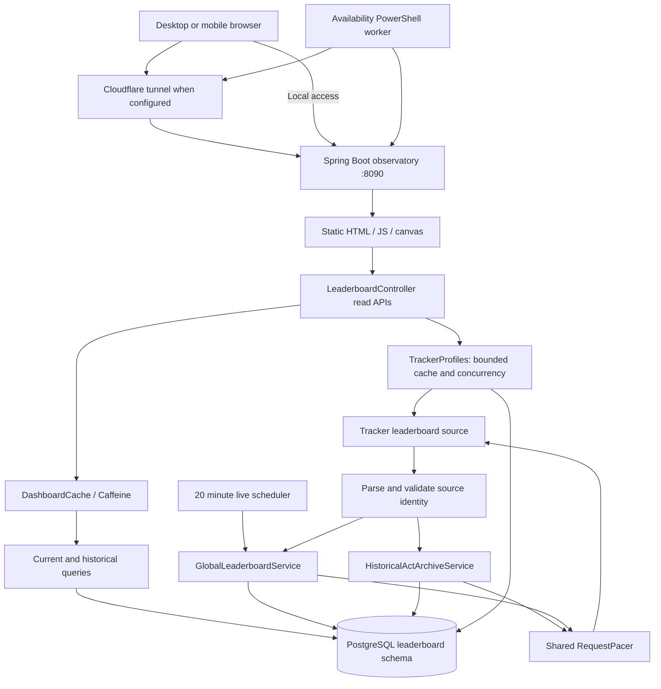
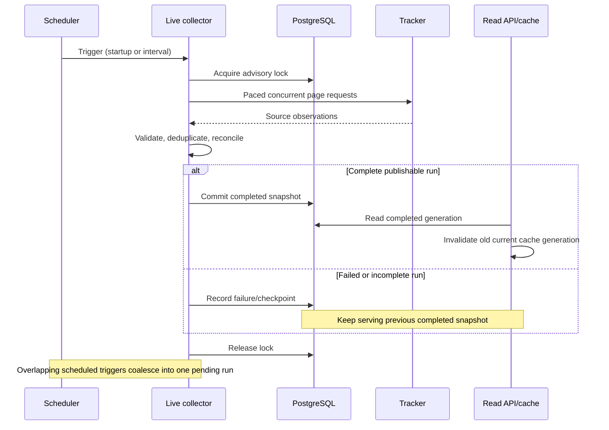
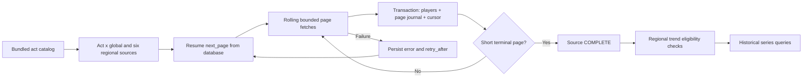
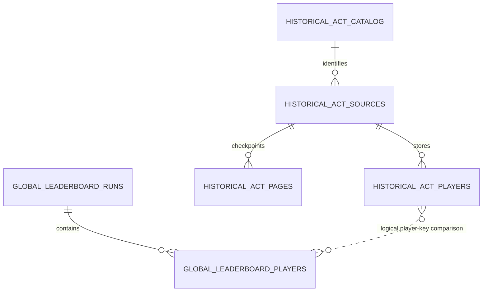

# Architecture and flows

## Current runtime

The ranked observatory is a standalone Java 21 / Spring Boot 3.5.6 module. It uses Spring MVC, JDBC, PostgreSQL, Flyway, Spring Security, and Caffeine. The browser is a vanilla HTML/JavaScript application with canvas charts. Default binding is loopback on port 8090. A tunnel can expose that service; it does not host or persist the application itself.

This diagram represents responsibilities, not separate deployed microservices. The pacer is process-local. Profile caching has its own lifetime. Status remains uncached.

## Live collection and publication

The live service uses startup-relative fixed-rate scheduling. The root README's wall-clock `:00/:20/:40` description should be reconciled with that implementation. Page concurrency is not request rate: a shared minimum interval between request starts limits admission independently of in-flight requests.

## Historical flow

A COMPLETE source means its collector reached a terminal condition. It does not independently establish that the upstream ladder was uncapped, correct, or comparable with other acts. Historical writes currently upsert source rows; they are not immutable, versioned analytical publications.

## Logical data relationships

The last relationship is conceptual, not an enforced stable-person foreign key. Display-name/player-key continuity is weaker than verified persistent player identity. Other stores include regional reconciliation observations, reported profile countries, and observatory accounts.

## Ownership map

- `GlobalLeaderboardService`: live schedule, orchestration, reconciliation, publication.
- `TrackerLeaderboardClient` and `RequestPacer`: transport, parsing, identity validation, retry/admission.
- `HistoricalActArchiveService`: act/source/page checkpointing and archive queries.
- `HistoricalTrendsQueryService`: historical catalog, capabilities, series, players, journey.
- `DashboardCache`: completed-run-aware read cache, archive key revisions.
- `CountryActivity`, `BoundaryMovement`, `PlayerTargets`: activity, inferred boundary transitions, overtake comparisons.
- `TrackerProfiles`: profile enrichment, bounded caching, reported-country recovery.
- `LeaderboardSecurity`, `ObservatoryAccounts`: local accounts and collection authorization.
- `leaderboard.js`, `act-trends.js`, `country-model.js`, `confidence-race.js`: browser presentation and some analytics policy.

## Target architecture, not yet deployed

```mermaid
flowchart LR
    Raw[Preserved source observations] --> Normalize[Versioned normalization and identity rules]
    Normalize --> Validate[Coverage and invariants]
    Validate --> Publish[Atomic publication revision]
    Publish --> Facts[Shared analytical facts]
    Facts --> Metrics[Versioned metrics and estimates]
    Metrics --> API[Typed response contracts]
    API --> View[Chart and table from same view model]
```

`HistoricalTrendFoundationService` is feature-gated. V8 lives under `src/deferred-migrations`, outside the active default migration path. Its canonical/versioned foundation must not be described as the default production data flow. Introduce that design through an additive migration and an explicit rollout, preserving ongoing extraction and existing reads.

